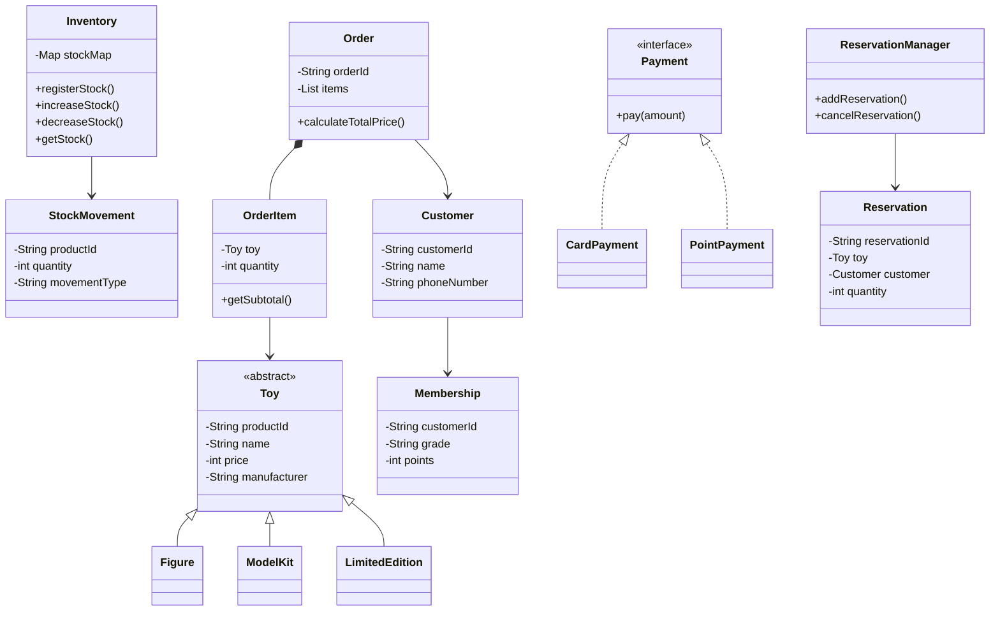

# 매니아를 위한 대규모 장난감 매장 관리 프로그램 클래스 설계

## 1. 설계 목표

일반적인 장난감 매장이 아닌 매니아를 대상으로 하는 대규모 장난감 전문 매장을 가정한다.

따라서 다양한 종류의 일반 상품을 관리하기보다는 다음과 같은 전문 상품을 중심으로 설계한다.

- 피규어 (애니메이션, 게임, 영화 캐릭터)
- 프라모델 (건담, 밀리터리 모델 등)
- 한정판 및 예약 상품
- 레진 키트
- 완성품 및 조립형 장난감

프로그램은 다음 기능을 제공한다.

1. 상품 정보 관리
2. 재고 관리
3. 고객 및 회원 관리
4. 주문 및 결제 관리
5. 한정판 및 예약 상품 관리
6. 상품 입고 및 출고 관리

설계에서 가장 중요하게 지킬 원칙은 다음 두 가지다.

- 단일 책임 원칙(SRP): 하나의 클래스는 하나의 책임만 가진다.
- 개방 폐쇄 원칙(OCP): 기존 코드를 수정하지 않고 새로운 기능이나 상품 유형을 확장할 수 있어야 한다.

## 2. 클래스 구성

클래스를 크게 5개의 영역으로 구분한다.

## Toy Store Management System

상품 관리 영역

`Toy` · `Figure` · `ModelKit` · `LimitedEdition`

재고 관리 영역

`Inventory` · `StockMovement`

회원 관리 영역

`Customer` · `Membership`

주문 및 결제 영역

`Order` · `OrderItem` · `Payment`

예약 관리 영역

`Reservation` · `ReservationManager`

## 3. 클래스별 책임 설계 (SRP)

단일 책임 원칙에 따라 각 클래스가 담당하는 역할을 명확하게 분리한다.

| 클래스 | 단일 책임 |
| --- | --- |
| Toy | 장난감의 기본 정보 관리 |
| Figure | 피규어 고유 정보 관리 |
| ModelKit | 프라모델 고유 정보 관리 |
| LimitedEdition | 한정판 상품 정보 관리 |
| Inventory | 상품의 현재 재고 관리 |
| StockMovement | 입고 및 출고 내역 관리 |
| Customer | 고객 정보 관리 |
| Membership | 회원 등급 및 혜택 관리 |
| Order | 주문 정보 관리 |
| OrderItem | 주문 상품 및 수량 관리 |
| Payment | 결제 처리 |
| Reservation | 예약 정보 관리 |
| ReservationManager | 예약 접수 및 취소 관리 |

예를 들어 `Toy` 클래스에서 상품 정보, 재고, 결제, 주문까지 모두 처리한다면 여러 책임이 하나의 클래스에 집중된다.

이를 위와 같이 분리하면 재고 관리 방식이 변경되어도 상품 정보 클래스에는 영향을 주지 않는다.

## 4. 클래스 설계 및 코드

Java를 기준으로 설계한다.

### 4-1. 상품 관리 클래스

모든 장난감의 공통 정보를 `Toy` 추상 클래스로 정의한다.

java

```java

public abstract class Toy {
    protected String productId;
    protected String name;
    protected int price;
    protected String manufacturer;

    public Toy(String productId, String name,
               int price, String manufacturer) {
        this.productId = productId;
        this.name = name;
        this.price = price;
        this.manufacturer = manufacturer;
    }

    public String getProductId() {
        return productId;
    }

    public String getName() {
        return name;
    }

    public int getPrice() {
        return price;
    }
}
```

상품 종류별로 별도의 클래스를 만들어 관리한다.

java

```java

public class Figure extends Toy {
    private String characterName;
    private String series;

    public Figure(String id, String name, int price,
                  String manufacturer,
                  String characterName, String series) {
        super(id, name, price, manufacturer);
        this.characterName = characterName;
        this.series = series;
    }
}

public class ModelKit extends Toy {
    private String grade;
    private int difficulty;

    public ModelKit(String id, String name, int price,
                    String manufacturer,
                    String grade, int difficulty) {
        super(id, name, price, manufacturer);
        this.grade = grade;
        this.difficulty = difficulty;
    }
}
```

한정판 상품은 별도의 클래스로 확장한다.

java

```java

public class LimitedEdition extends Toy {
    private int productionQuantity;
    private String releaseDate;

    public LimitedEdition(String id, String name, int price,
                          String manufacturer,
                          int productionQuantity,
                          String releaseDate) {
        super(id, name, price, manufacturer);
        this.productionQuantity = productionQuantity;
        this.releaseDate = releaseDate;
    }
}
```

OCP 적용 이유

새로운 상품 종류인 `ResinKit`을 추가하고 싶다면 기존 `Toy`, `Figure`, `ModelKit` 코드를 수정할 필요 없이 새로운 클래스를 생성하면 된다.

### 4-2. 재고 관리 클래스

재고 관리는 상품 정보와 독립적으로 처리한다.

java

```java

public class Inventory {
    private Map<String, Integer> stockMap = new HashMap<>();

    // 재고 등록
    public void registerStock(String productId, int quantity) {
        stockMap.put(productId, quantity);
    }

    // 재고 증가
    public void increaseStock(String productId, int quantity) {
        stockMap.merge(productId, quantity, Integer::sum);
    }

    // 재고 감소
    public void decreaseStock(String productId, int quantity) {
        int current = stockMap.getOrDefault(productId, 0);

        if (current < quantity) {
            throw new IllegalStateException("재고 부족");
        }

        stockMap.put(productId, current - quantity);
    }

    // 재고 조회
    public int getStock(String productId) {
        return stockMap.getOrDefault(productId, 0);
    }
}
```

재고의 입출고 이력을 담당하는 클래스는 별도로 분리한다.

java

```java

public class StockMovement {
    private String productId;
    private int quantity;
    private String movementType;
    private LocalDateTime movementDate;
}
```

### 4-3. 고객 및 회원 관리 클래스

java

```java

public class Customer {
    private String customerId;
    private String name;
    private String phoneNumber;

    public Customer(String customerId, String name,
                    String phoneNumber) {
        this.customerId = customerId;
        this.name = name;
        this.phoneNumber = phoneNumber;
    }
}

public class Membership {
    private String customerId;
    private String grade;
    private int points;

    public void addPoints(int amount) {
        points += amount;
    }

    public void usePoints(int amount) {
        if (points < amount) {
            throw new IllegalArgumentException("포인트 부족");
        }
        points -= amount;
    }
}
```

고객 정보와 회원 등급 및 포인트를 분리하여 회원 혜택 정책이 바뀌더라도 고객 정보 관리에는 영향을 주지 않는다.

### 4-4. 주문 및 결제 관리 클래스

java

```java

public class Order {
    private String orderId;
    private Customer customer;
    private List<OrderItem> items;
    private LocalDateTime orderDate;

    public int calculateTotalPrice() {
        return items.stream()
                .mapToInt(OrderItem::getSubtotal)
                .sum();
    }
}

public class OrderItem {
    private Toy toy;
    private int quantity;

    public int getSubtotal() {
        return toy.getPrice() * quantity;
    }
}
```

결제는 주문 클래스와 분리한다.

또한 결제 방식이 추가될 것을 고려하여 인터페이스를 사용한다.

java

```java

public interface Payment {
    void pay(int amount);
}

public class CardPayment implements Payment {
    @Override
    public void pay(int amount) {
        System.out.println("카드 결제: " + amount);
    }
}

public class PointPayment implements Payment {
    @Override
    public void pay(int amount) {
        System.out.println("포인트 결제: " + amount);
    }
}
```

OCP 적용 이유

추후 간편결제나 상품권 결제가 추가되어도 기존 `Order`나 `Payment` 인터페이스를 수정할 필요 없이 새로운 결제 클래스를 추가하면 된다.

### 4-5. 예약 관리 클래스

매니아 전문 매장이므로 한정판 상품과 출시 예정 상품의 예약 기능이 중요하다.

java

```java

public class Reservation {
    private String reservationId;
    private Customer customer;
    private Toy toy;
    private int quantity;
    private LocalDateTime reservationDate;
    private String status;
}

public class ReservationManager {
    private List<Reservation> reservations = new ArrayList<>();

    public void addReservation(Reservation reservation) {
        reservations.add(reservation);
    }

    public void cancelReservation(String reservationId) {
        reservations.removeIf(
            r -> r.getReservationId().equals(reservationId)
        );
    }
}
```

## 5. OCP를 고려한 확장 구조

개방 폐쇄 원칙을 가장 잘 보여주는 부분은 상품 종류와 결제 방식이다.

상품 확장 구조

Toy (추상 클래스)

Figure

피규어

ModelKit

프라모델

LimitedEdition

한정판

새로운 상품은 Toy를 상속하여 추가한다.

결제 확장 구조

Payment (인터페이스)

CardPayment

PointPayment

EasyPayment

새로운 결제 방식은 Payment를 구현하여 추가한다.

## 6. 최종 클래스 다이어그램

전체 클래스의 관계를 요약하면 다음과 같다.

mermaid



## 7. 설계 원칙 적용 결과

| 설계 원칙 | 적용 방법 | 기대 효과 |
| --- | --- | --- |
| SRP | 상품, 재고, 주문, 결제, 예약 클래스 분리 | 유지보수 용이 |
| SRP | 고객과 회원 정보 분리 | 회원 정책 변경에 유연 |
| OCP | Toy 추상 클래스 상속 | 새로운 상품 추가 용이 |
| OCP | Payment 인터페이스 구현 | 새로운 결제 방식 추가 용이 |

### 최종 결론

본 프로그램은 매니아를 위한 대규모 장난감 전문 매장의 특성을 반영하여 피규어, 프라모델, 한정판 상품 및 예약 상품을 중심으로 설계하였다.

단일 책임 원칙(SRP) 을 적용하여 상품, 재고, 회원, 주문, 결제, 예약 기능을 각각 별도의 클래스로 분리하였다. 이를 통해 하나의 기능이 변경되더라도 다른 기능에 미치는 영향을 최소화하였다.

개방 폐쇄 원칙(OCP) 을 적용하여 상품은 `Toy` 추상 클래스를 상속하고 결제 방식은 `Payment` 인터페이스를 구현하도록 설계하였다. 따라서 새로운 상품 종류나 결제 방식이 추가되더라도 기존 코드를 수정하지 않고 확장할 수 있다.

결과적으로 유지보수성과 확장성이 높은 대규모 장난감 전문 매장 관리 시스템을 설계할 수 있다.
